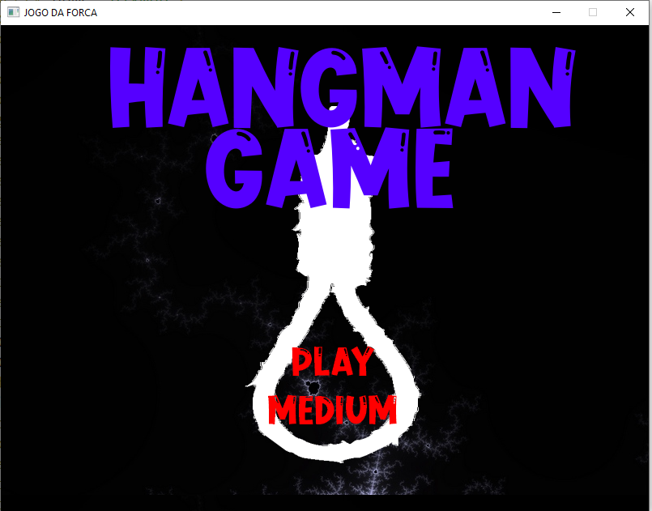
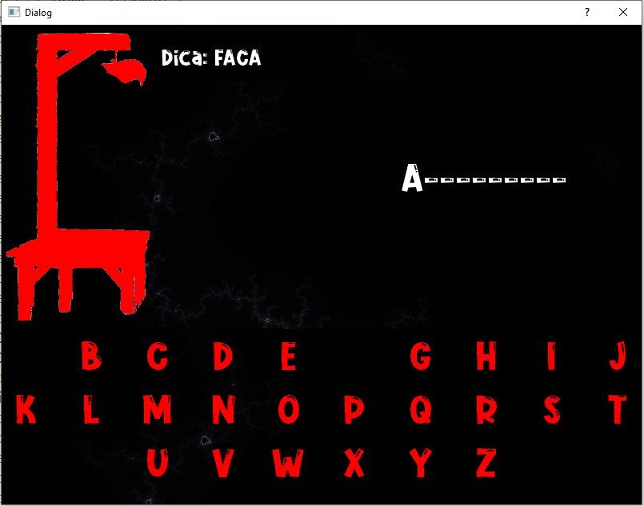
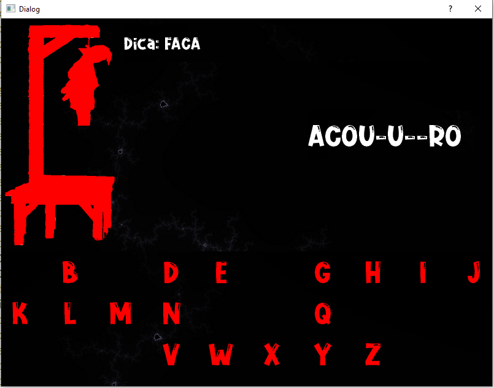
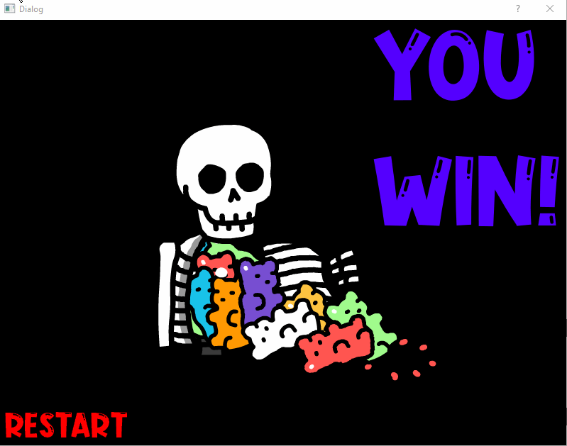
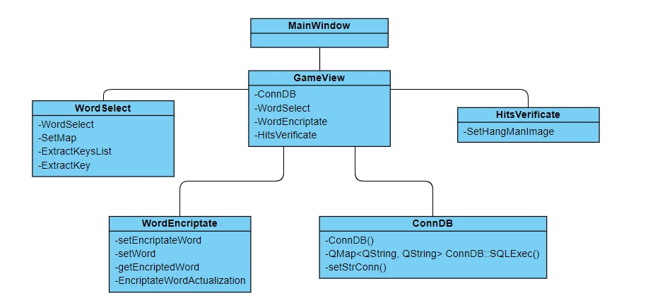

# Jogo da Forca

  

Releitura do clássico **jogo da forca** com temática de **suspense e terror**, desenvolvida em **C++ com Qt** como trabalho em equipe (2019).

## Requisitos atendidos (user stories)

- Palavras de temas variados, cada uma com uma **dica**.
- Banco com muitas palavras (**SQLite**), para o jogo não ficar repetitivo.
- Elementos de terror e suspense (cores, imagens e animações).
- **Níveis de dificuldade** escolhidos pelo jogador.

## Telas

| Menu | Jogo | Jogo |
|:---:|:---:|:---:|
|  |  |  |

| Game over | Vitória |
|:---:|:---:|
|  |  |

## Como funciona

O jogador vê o número de letras e a dica de cada palavra. A cada letra errada, uma parte do enforcado é desenhada; com 5 erros, o jogo termina. Ao acertar todas as palavras do nível escolhido, o jogador vence.

## Arquitetura

Orientação a objetos com classes pequenas e coesas:

| Classe | Responsabilidade |
|---|---|
| `ConnDB` | Conexão com o SQLite (`BD/Regs.db`) e leitura das palavras do nível |
| `WordSelect` | Seleção da palavra e da dica |
| `WordEncriptate` | Máscara da palavra (`----`) e revelação das letras |
| `HitsVerificate` | Imagem do enforcado conforme o número de erros |
| `MainWindow`, `GameView`, `GameOverView`, `YouWinView` | Telas (Qt Widgets) |

## Como executar

1. Instale o **Qt 5** com o Qt Creator (o projeto foi feito no Qt 5.12, com MinGW e MSVC).
2. Abra `JogoDaForca/JogoDaForca.pro` no Qt Creator e execute.
3. O jogo procura o banco em `BD/Regs.db` **dois níveis acima** da pasta do executável. Use o build padrão do Qt Creator (`build-JogoDaForca-.../debug` na raiz do repositório) para que o caminho funcione.

## Equipe

- Silvio Ferreira Jr — [@SilvioFJr](https://github.com/SilvioFJr)
- Pedro Moreira — [@phms777](https://github.com/phms777)
- [@penabranco](https://github.com/penabranco)
- [@Bzaum](https://github.com/Bzaum)
